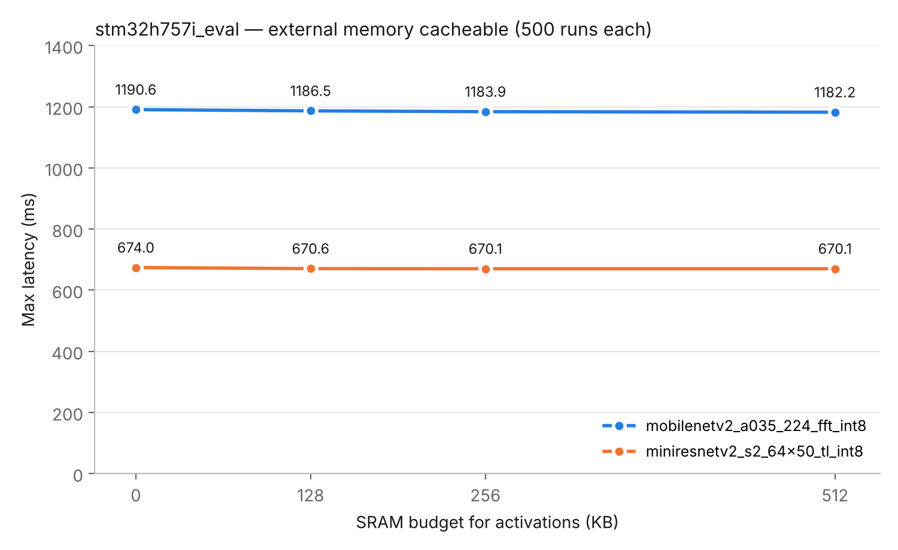
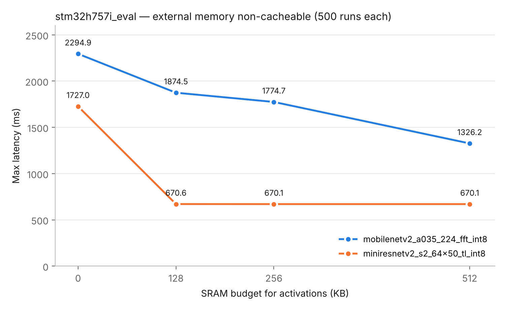

# mcu-memory-hierarchy-bench

**A portable, bare-metal framework for measuring how the placement of neural-network activations across a microcontroller's memory hierarchy affects inference latency.**

---

## Contents
1. [Motivation](#1-motivation)
2. [Research questions](#2-research-questions)
3. [What the framework does](#3-what-the-framework-does)
4. [How it works, step by step](#4-how-it-works-step-by-step)
5. [Repository layout](#5-repository-layout)
6. [Boards](#6-boards)
7. [Experiments](#7-experiments)
8. [Results so far](#8-results-so-far)
9. [Methodology and measurement rules](#9-methodology-and-measurement-rules)
10. [Getting started](#10-getting-started)
11. [Adding a board, model or experiment](#11-adding-a-board-model-or-experiment)
12. [Limitations](#12-limitations)
13. [Roadmap](#13-roadmap)

---

## 1. Motivation

Microcontrollers run neural networks with very little fast memory. A typical Cortex-M7 has a few hundred kilobytes of on-chip SRAM, while a vision model can need several megabytes of intermediate data (activations) during one inference. When the activations do not fit, they have to live somewhere slower: external SDRAM, PSRAM, or even flash/SD.

Every slower tier adds latency, but how much depends on many things: how much fast memory is left, which tensors move out, whether the CPU cache can hide the slow accesses, and what it costs to manage the hierarchy (memory-protection settings, cache maintenance, DMA copies).

These effects are usually discussed in general terms. This project measures them directly on real hardware, with a setup that keeps everything constant except the one thing being studied.

## 2. Research questions

- **Q1 — Placement sensitivity.** For a fixed model and a fixed fast-memory budget, how much does latency increase as activations move from on-chip SRAM to an external memory tier?
- **Q2 — Role of the cache.** How much of that penalty does the data cache hide, and what is the raw cost when external memory is not cached?
- **Q3 — Cost of managing the hierarchy.** What does it cost to reprogram the MPU, clean/invalidate the data cache, and move data between tiers with DMA?
- **Q4 — Portability of conclusions.** Do the answers hold across different MCUs and memory systems? (The framework is built so that new boards can be added without touching models or experiments.)

## 3. What the framework does

- Converts any **int8 TensorFlow Lite** model into C tables and weights, and runs it with its own inference engine that is **bit-exact with TFLite** — every layer output matches.
- Takes a **placement plan** that says, tensor by tensor, whether each activation lives in fast SRAM or in the external tier, and turns it into a C placement table.
- Runs the model **in place**: each kernel reads and writes its tensors directly in whichever memory they were placed in, with no hidden copies.
- **Verifies** every layer against TFLite on the board before timing anything.
- **Times** inference with the CPU cycle counter: warm-up runs, then hundreds of timed runs stored in RAM and printed afterwards.
- Prints a **CSV line** per configuration, so results go straight into tables and plots.
- Keeps all **board-specific code** in one small port per board, so the same models and experiments run on any supported MCU.

## 4. How it works, step by step

```
  model.tflite                         placement plan (per SRAM budget)
       │                                          │
       ▼                                          ▼
 tools/tflite2c.py                     tools/make_placement.py
  - parse model                         - read plan
  - integer quantisation params         - pack SRAM tensors by lifetime into an arena ≤ budget
  - numpy reference vs TFLite           - give external tensors their addresses
  - per-layer reference sums            - check no two live tensors overlap
       │                                          │
       ▼                                          ▼
 models/<model>/                        <board>/placements/<model>/s<KB>/
  nn_model.c  nn_weights.c                nn_place.c
       │                                          │
       └──────────────┬───────────────────────────┘
                      ▼
        core/engine  +  core/bench/<study>.c        (portable, no board code)
                      │
                      ▼
               <board>/port/                         (clocks, timer, UART,
                      │                               external memory, MPU, caches, DMA)
                      ▼
        <board>/experiments/NN_<name>/   make  →  flash  →  read serial log
                      │
                      ▼
        <board>/experiments/NN_<name>/results/   CSV + plots
```

What happens on the board when a placement-sweep binary starts:
1. Clocks, cycle counter and UART come up.
2. External memory is initialised and tested.
3. Memory attributes (MPU regions, caches) are set once.
4. One inference runs and every layer is checked against the TFLite reference sums.
5. Warm-up runs, then N timed runs; each run's cycle count is stored.
6. All cycle counts, min/mean/max and the output checksum are printed, followed by one CSV line.

## 5. Repository layout

Each MCU gets **one self-contained parent folder** that holds everything needed to run the experiments on it: the shared engine and tools, the board port, the placements, the experiments and their results. A new MCU is added as a new parent folder next to `stm32h757i_eval/`.

```
mcu-memory-hierarchy-bench/                 (repo root)
├── README.md                               this file
├── LICENSE
└── mcu-memory-hierarchy-bench/
    └── stm32h757i_eval/                    ◄── parent folder for the STM32H757I-EVAL
        ├── README.md                       board setup: clocks, memory map, MPU, flags
        ├── RESULTS.md                      all results for this board on one page
        ├── core/
        │   ├── include/                    port.h (board contract), port_overheads.h, bench.h
        │   ├── engine/                     int8 inference engine, bit-exact with TFLite
        │   └── bench/                      studies: placement_sweep.c, overhead_bench.c, common.c
        ├── models/                         generated tables + weights for each model
        │   ├── mobilenetv2_a035_224_fft_int8/
        │   └── miniresnetv2_s2_64x50_tl_int8/
        ├── tools/                          tflite2c.py, placement.py, make_placement.py
        ├── docs/                           ARCHITECTURE.md, PORTING.md, STUDIES.md, ROADMAP.md
        ├── port/                           board code, Makefile, startup, linker script, CMSIS
        ├── placements/<model>/s<KB>/       placement tables for each SRAM budget
        ├── experiments/
        │   ├── 01_placement_sweep_cached/      Makefile, README.md, results/
        │   ├── 02_placement_sweep_noncached/   Makefile, README.md, results/
        │   └── 03_overhead_bench/              Makefile, README.md, results/
        ├── host/                           PC build for correctness checks (no timing claims)
        └── _template_board/                port stubs + experiment template for a new MCU
```

In the rest of this README, paths such as `core/` or `experiments/` are relative to the board folder (`mcu-memory-hierarchy-bench/stm32h757i_eval/`).

## 6. Boards

| Board folder | Core | Fast memory | External tier | Status |
|---|---|---|---|---|
| [`stm32h757i_eval/`](mcu-memory-hierarchy-bench/stm32h757i_eval/) | Cortex-M7 @ 400 MHz | 512 KB AXI SRAM, 128 KB DTCM | 32 MB SDRAM (FMC, 32-bit, 100 MHz) | 3 experiments measured |
| [`host/`](mcu-memory-hierarchy-bench/stm32h757i_eval/host/) | PC | — | emulated | correctness checks (inside each board folder) |
| [`_template_board/`](mcu-memory-hierarchy-bench/stm32h757i_eval/_template_board/) | — | — | — | starting point for a new MCU |

## 7. Experiments

Experiments live inside each board folder, under `experiments/`. Each has a `Makefile`, a `README.md` (question, setup, results, observations) and a `results/` folder.

| Board | # | Experiment | Question |
|---|---|---|---|
| stm32h757i_eval | 01 | [Placement sweep, SDRAM cacheable](mcu-memory-hierarchy-bench/stm32h757i_eval/experiments/01_placement_sweep_cached/) | Q1 with the cache on |
| stm32h757i_eval | 02 | [Placement sweep, SDRAM non-cacheable](mcu-memory-hierarchy-bench/stm32h757i_eval/experiments/02_placement_sweep_noncached/) | Q1 + Q2, raw external-memory cost |
| stm32h757i_eval | 03 | [Memory-management overheads](mcu-memory-hierarchy-bench/stm32h757i_eval/experiments/03_overhead_bench/) | Q3 |

Models used:

| Model | Domain | Input | Layers | Weights | Peak activations |
|---|---|---|---|---|---|
| `mobilenetv2_a035_224_fft_int8` | vision | 224×224×3 uint8 | 67 | 518 KB | > 512 KB (always some SDRAM) |
| `miniresnetv2_s2_64x50_tl_int8` | audio | 64×50×1 int8 | 36 | 443 KB | 107 KB |

SRAM budgets: 512, 256, 128 and 0 KB. Placement plans for each budget were produced with a tiling/placement planner and converted with `tools/make_placement.py`; each tensor is placed wholly in one tier.

## 8. Results so far

Full page: [RESULTS.md](mcu-memory-hierarchy-bench/stm32h757i_eval/RESULTS.md).

**Max latency (ms), 500 timed runs per configuration, STM32H757 @ 400 MHz**

| SRAM budget | MobileNetV2 cached | MobileNetV2 non-cached | MiniResNet cached | MiniResNet non-cached |
|---|---|---|---|---|
| 512 KB | 1182.167 | 1326.232 | 670.140 | 670.140 * |
| 256 KB | 1183.895 | 1774.652 | 670.140 | 670.140 * |
| 128 KB | 1186.486 | 1874.521 | 670.597 | 670.597 * |
| 0 KB | 1190.576 | 2294.926 | 673.956 | 1726.977 |
| **512 → 0 KB** | **+0.71 %** | **+73.0 %** | **+0.57 %** | **+157.7 %** |

\* nothing placed in SDRAM at this budget, so the cache setting cannot matter.

<p>


</p>

**Memory-management overheads (1000 runs each)**

| Operation | Mean | Max |
|---|---|---|
| MPU region reprogram | 0.076 µs (~30 cycles) | 0.105 µs |
| D-cache clean + invalidate, 128 KB | 80.685 µs | 80.717 µs |
| MDMA copy 128 KB SRAM → SDRAM | 333.582 µs (392.9 MB/s) | 333.640 µs |

**What this shows**
1. With caching enabled, external SDRAM is almost as fast as SRAM for these models: moving every activation off-chip costs under 1 %.
2. The data cache is what makes this true. Without it, the same move costs 73 % (MobileNetV2) and 158 % (MiniResNet).
3. Without the cache, every kilobyte of SRAM matters; MobileNetV2's biggest jump is 512 → 256 KB, when its large early feature maps leave SRAM.
4. Models whose kernels re-read inputs many times (MiniResNet's 7×7/3×3 convolutions) are the most sensitive to an uncached slow tier.
5. Explicit management is cheap: MPU changes are ~30 cycles, cache maintenance ~8 cycles per line, and DMA runs at ~98 % of the SDRAM bus peak. Staging data with DMA costs far less than running uncached from SDRAM.

## 9. Methodology and measurement rules

These rules hold for every experiment and every board:

- **One variable at a time.** Within an experiment only the studied parameter changes (e.g. the placement table); model, engine, clocks and memory settings stay identical.
- **Bit-exact correctness first.** The tools check every layer against the TFLite interpreter on the PC, and every board run re-checks every layer before timing. The output checksum must be identical across all placements of a model.
- **Whole-tensor, in-place placement.** A tensor lives entirely in one tier and is read and written where it lives.
- **Fixed input.** A deterministic pseudo-random input (LCG, seed 12345) is used for every run.
- **Warm-up, then timing.** 10 warm-up runs, then 500 timed runs (1000 for micro-benchmarks); timings are stored in RAM and printed only after the loop.
- **Cycle-accurate timer.** The CPU cycle counter (DWT on Cortex-M), converted with the board's real clock.
- **No debugger attached** while timing: flash, disconnect, reset, read the serial port.
- **Memory attributes set once** at boot and documented in the board README.
- **Report min, mean and max**, plus the checksum, in a fixed CSV format.

Per-board details (clock tree, memory map, MPU regions, compiler flags) are in each board's `README.md`.

## 10. Getting started

**Requirements**
- Python 3 with `numpy` and `tensorflow` (for model conversion and reference checks)
- `make` and a GCC toolchain for each target (`arm-none-eabi-gcc` for Cortex-M)
- A flasher (STM32CubeProgrammer CLI, OpenOCD, or STM32CubeIDE) and a serial terminal

**Go to the board folder**
```
cd mcu-memory-hierarchy-bench/stm32h757i_eval
```

**Check a model on your PC first**
```
cd host/port
make MODEL=miniresnetv2_s2_64x50_tl_int8 SRAM_KB=0 run
```
The output must say `all layers match`.

**Run an experiment on the STM32H757I-EVAL**
```
cd experiments/01_placement_sweep_cached
make                                                     # all 8 configurations
make one MODEL=mobilenetv2_a035_224_fft_int8 SRAM_KB=128 # one configuration
```
Binaries appear in `build/placement_sweep/<model>/s<KB>/bench.elf`.

**Flash and read**
```
STM32_Programmer_CLI -c port=SWD -w build/placement_sweep/<model>/s<KB>/bench.elf -v -rst
```
Disconnect the debugger, reset, and read the ST-LINK virtual COM port at 115200 8N1. Copy the `CSV,...` line into the experiment's `results/results.csv`.

STM32CubeIDE users can import `mcu-memory-hierarchy-bench/stm32h757i_eval/port` as a *Makefile Project with Existing Code*.

## 11. Adding a board, model or experiment

**New board (MCU)**
1. Copy the H7 parent folder and drop its board-specific parts:
   ```
   cd mcu-memory-hierarchy-bench
   cp -r stm32h757i_eval <new_board>
   cd <new_board>
   rm -rf port placements experiments/*/results/* RESULTS.md
   cp -r _template_board/port port
   cp -r _template_board/placements placements
   ```
2. Implement `port/port.c` (about a dozen small functions: clock, cycle counter, UART, external memory, MPU/cache setup, scratch memory) and, for overhead experiments, `port_overheads.c`.
3. Add startup, linker script, device headers and a `Makefile` in `port/` (start from `port/Makefile.example`).
4. Generate placements into `placements/`.
5. Set `PORT` in each experiment Makefile, build, run, store results in `results/`, and write the board's `README.md` and `RESULTS.md`.
Details: [docs/PORTING.md](mcu-memory-hierarchy-bench/stm32h757i_eval/docs/PORTING.md).

**New model**
```
python3 tools/tflite2c.py model.tflite models/<model>
python3 tools/make_placement.py model.tflite plan.html placements/<model>/s<KB> models/<model>/nn_model.c
```

**New experiment**
Create `experiments/NN_<name>/` with a `Makefile` that calls `../../port/Makefile` with the right options, a `README.md`, and a `results/` folder. If it needs a new kind of measurement, add a study in `core/bench/` — see [docs/STUDIES.md](mcu-memory-hierarchy-bench/stm32h757i_eval/docs/STUDIES.md).

Further reading: [docs/ARCHITECTURE.md](mcu-memory-hierarchy-bench/stm32h757i_eval/docs/ARCHITECTURE.md) (layers and the port contract).

## 12. Limitations

- Kernels are portable C (with SMLAD for 1×1 convolutions), not a vendor-optimised library, so absolute latencies are higher than CMSIS-NN would give. Comparisons within an experiment are like-for-like.
- Weights stay in internal flash; only activations are placed across tiers so far.
- Placement is whole-tensor; tiled or streamed placements are future work.
- Results so far come from one board. The STM32H757 runs at 400 MHz (SMPS supply, no VOS0).
- The current STM32H757 results were measured with per-configuration STM32CubeIDE projects that preceded this layout; the refactored code keeps the same kernels, harness logic, clock, memory and MPU settings.
- Differences below ~0.1 % are within code-alignment effects and should be treated as noise.

## 13. Roadmap

- More boards with different SRAM / external-memory ratios (other Cortex-M7/M55/M85, RISC-V, ESP32-S3 with PSRAM).
- More external tiers: OctoSPI/HyperRAM, QSPI PSRAM, SD card.
- DMA staging of hot tensors into SRAM versus computing in place.
- Tiled / row-streamed placements.
- Weights in external memory.
- Optimised kernel backends, per-layer timing, energy per inference.

Details: [docs/ROADMAP.md](mcu-memory-hierarchy-bench/stm32h757i_eval/docs/ROADMAP.md).
