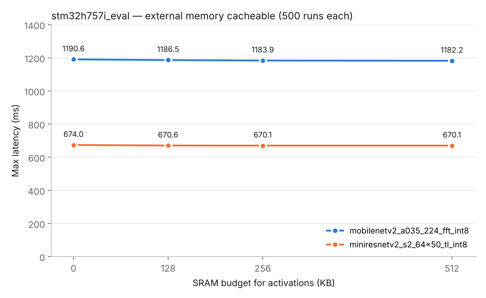
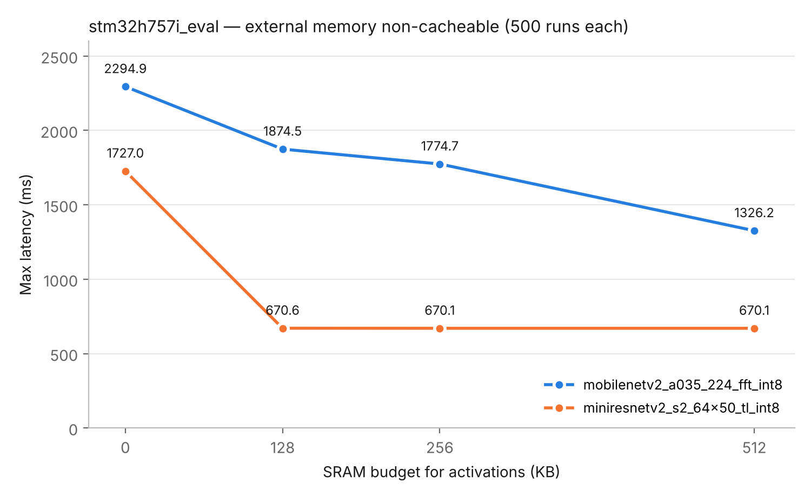

# mcu-memory-hierarchy-bench

A portable, bare-metal framework for measuring how **memory placement of neural-network activations** affects inference latency on microcontrollers.

> **Research question.** For a fixed model and a fixed amount of fast on-chip memory, how much latency is paid when part — or all — of the activation working set lives in a slower memory tier, and what does it cost to manage that hierarchy explicitly (MPU, caches, DMA)?

The framework separates *what is measured* from *where it runs*:

- **Models** are generated once from any int8 `.tflite` and run bit-exactly against TFLite.
- **Placements** say, tensor by tensor, which memory tier each activation lives in.
- **Studies** are MCU-independent benchmark programs.
- **Ports** adapt everything to a board through one small C interface.

Adding a new MCU means writing one port; every model, placement and study then runs on it unchanged.

---

## Architecture

```
            ┌──────────────── tools/ (host, Python) ────────────────┐
 .tflite ──►│ tflite2c.py ──► models/<model>/        (C model, weights, TFLite reference)
 plan    ──►│ make_placement.py ──► placements/<board>/<model>/s<KB>/   (nn_place.c)
            └────────────────────────────────────────────────────────┘
                                   │
            ┌──────────── core/ (portable C, no board code) ─────────┐
            │ engine/   int8 inference engine, bit-exact with TFLite │
            │ bench/    studies: placement_sweep, overhead_bench     │
            │ include/  port.h, port_overheads.h  ◄── the contract   │
            └────────────────────────────────────────────────────────┘
                                   │
            ┌──────────────── ports/<board>/ ────────────────────────┐
            │ clocks, timer, UART, external memory, MPU/caches, DMA  │
            │ startup, linker script, Makefile                       │
            └────────────────────────────────────────────────────────┘
                                   │
                         UART log ──► experiments/<NN_name>/results/
```

See [docs/ARCHITECTURE.md](docs/ARCHITECTURE.md) and [docs/PORTING.md](docs/PORTING.md).

---

## Supported targets

| Port | Core / clock | Fast memory | Slow tier | Status |
|---|---|---|---|---|
| `stm32h757i_eval` | Cortex-M7 @ 400 MHz | AXI SRAM 512 KB, DTCM 128 KB | FMC SDRAM 32 MB | measured |
| `host` | PC (x86/ARM) | — | emulated array | functional check only |
| `_template` | — | — | — | starting point for new boards |

## Studies

| Study | Question | Source | Needs |
|---|---|---|---|
| `placement_sweep` | Latency vs SRAM budget for activations, overflow to the slow tier | `core/bench/placement_sweep.c` | `port.h` |
| `overhead_bench` | Cost of MPU reprogramming, cache maintenance, DMA fast→slow copy | `core/bench/overhead_bench.c` | `port.h` + `port_overheads.h` |

Details: [docs/STUDIES.md](docs/STUDIES.md).

## Models

| Model | Domain | Layers | Weights |
|---|---|---|---|
| `mobilenetv2_a035_224_fft_int8` | vision (224×224×3) | 67 | 518 KB |
| `miniresnetv2_s2_64x50_tl_int8` | audio (64×50×1) | 36 | 443 KB |

---

## Experiments — `stm32h757i_eval`

| # | Experiment | Headline |
|---|---|---|
| 01 | [Placement sweep, SDRAM cacheable](experiments/01_placement_sweep_cached/) | 512 → 0 KB SRAM: MobileNetV2 +0.71 %, MiniResNet +0.57 % |
| 02 | [Placement sweep, SDRAM non-cacheable](experiments/02_placement_sweep_noncached/) | 512 → 0 KB SRAM: MobileNetV2 +73.0 %, MiniResNet +157.7 % |
| 03 | [Memory-management overheads](experiments/03_overhead_bench/) | MPU reprogram 0.076 µs · 128 KB cache clean+inv 80.7 µs · 128 KB MDMA 333.6 µs (392.9 MB/s) |

Max latency (ms), 500 timed runs per configuration:

| SRAM budget | MobileNetV2 (01) | MobileNetV2 (02) | MiniResNet (01) | MiniResNet (02) |
|---|---|---|---|---|
| 512 KB | 1182.167 | 1326.232 | 670.140 | 670.140 * |
| 256 KB | 1183.895 | 1774.652 | 670.140 | 670.140 * |
| 128 KB | 1186.486 | 1874.521 | 670.597 | 670.597 * |
| 0 KB | 1190.576 | 2294.926 | 673.956 | 1726.977 |

\* no tensors in SDRAM at this budget, so the cache attribute has no effect (value from 01).

<p>


</p>

Board setup (clocks, memory map, MPU, compiler flags): [ports/stm32h757i_eval/README.md](ports/stm32h757i_eval/README.md).

---

## Quick start

**Check on a PC (no hardware)**
```
cd ports/host
make MODEL=miniresnetv2_s2_64x50_tl_int8 SRAM_KB=0 run
```

**Build an experiment**
```
cd experiments/01_placement_sweep_cached
make                                                    # all configurations
make one MODEL=mobilenetv2_a035_224_fft_int8 SRAM_KB=128
make PORT=<board>                                       # same experiment on another port
```
Output: `build/<board>/<study>/<model>/s<KB>/bench.elf` (+ `.bin`, `.map`).
Single builds without an experiment folder: `make -C ports/<board> STUDY=... MODEL=... SRAM_KB=...`.

**Flash and read**
```
STM32_Programmer_CLI -c port=SWD -w build/.../bench.elf -v -rst
```
then open the board's serial port (115200 8N1), or import the port folder in STM32CubeIDE as a *Makefile project with existing code*. Disconnect the debugger while timing.

**Add a model**
```
python3 tools/tflite2c.py model.tflite models/<model>
python3 tools/make_placement.py model.tflite plan.html placements/<board>/<model>/s<KB> models/<model>/nn_model.c
```

Requirements: Python 3 with `numpy` and `tensorflow`; a GCC toolchain for each target (`arm-none-eabi-gcc` for Cortex-M).

---

## Repository layout

```
core/
  include/   port.h  port_overheads.h  bench.h
  engine/    nn_engine.c  nn_engine.h
  bench/     common.c  placement_sweep.c  overhead_bench.c
ports/
  stm32h757i_eval/   port.c  port_overheads.c  Makefile  README.md  startup/  linker/  cmsis/
  host/              port.c  Makefile
  _template/         port.c  port_overheads.c
models/<model>/                  nn_model.c/.h  nn_weights.c/.h
placements/<board>/<model>/s<KB>/ nn_place.c/.h
experiments/NN_<name>/            Makefile, README.md, results/ (CSV, plots)
tools/                            tflite2c.py  placement.py  make_placement.py
docs/                             ARCHITECTURE.md  PORTING.md  STUDIES.md  ROADMAP.md
```
