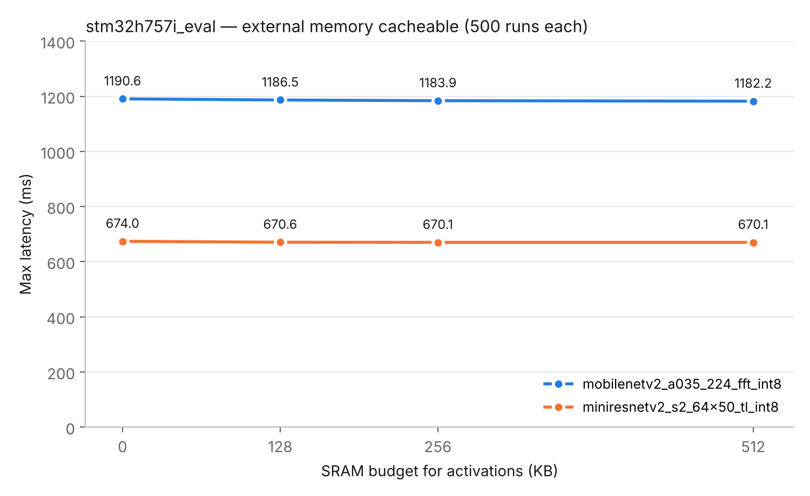

# 01 — Placement sweep, external memory cacheable

**Question:** how does inference latency change as the SRAM budget for activations shrinks and tensors move to external SDRAM, with SDRAM cacheable?

| Item | Value |
|---|---|
| Study code | `core/bench/placement_sweep.c` |
| Port | `stm32h757i_eval` (setup: `ports/stm32h757i_eval/README.md`) |
| Models | `mobilenetv2_a035_224_fft_int8`, `miniresnetv2_s2_64x50_tl_int8` |
| SRAM budgets | 512, 256, 128, 0 KB (overflow → SDRAM) |
| External memory | MPU region 0 @ 0xD0000000, Normal write-back read/write-allocate, set once |
| Runs | 10 warm-up + 500 timed, DWT cycles |

## Build
```
make                                   # all 8 configurations
make one MODEL=<model> SRAM_KB=<KB>    # a single configuration
```
ELFs: `build/stm32h757i_eval/placement_sweep/<model>/s<KB>/bench.elf`

## Results (`results/results.csv`)
| model | budget KB | act SRAM KB | act ext KB | min ms | mean ms | max ms | checksum |
|---|---|---|---|---|---|---|---|
| mobilenetv2_a035_224_fft_int8 | 512 | 392 | 735 | 1182.070 | 1182.108 | 1182.167 | 0x6E135E66 |
| mobilenetv2_a035_224_fft_int8 | 256 | 196 | 686 | 1183.740 | 1183.825 | 1183.895 | 0x6E135E66 |
| mobilenetv2_a035_224_fft_int8 | 128 | 98 | 882 | 1186.279 | 1186.385 | 1186.486 | 0x6E135E66 |
| mobilenetv2_a035_224_fft_int8 | 0 | 0 | 882 | 1190.413 | 1190.490 | 1190.576 | 0x6E135E66 |
| miniresnetv2_s2_64x50_tl_int8 | 512 | 107 | 0 | 670.071 | 670.115 | 670.140 | 0x62FA5CE4 |
| miniresnetv2_s2_64x50_tl_int8 | 256 | 107 | 0 | 670.071 | 670.115 | 670.140 | 0x62FA5CE4 |
| miniresnetv2_s2_64x50_tl_int8 | 128 | 107 | 0 | 670.521 | 670.553 | 670.597 | 0x62FA5CE4 |
| miniresnetv2_s2_64x50_tl_int8 | 0 | 0 | 110 | 673.534 | 673.730 | 673.956 | 0x62FA5CE4 |

Slowdown 512 → 0 KB (max): MobileNetV2 **+0.71 %**, MiniResNet **+0.57 %**.



## Observations
- With SDRAM cacheable, moving all activations off-chip costs under 1 %.
- MiniResNet's activation peak is 107 KB, so 512/256/128 KB place nothing in SDRAM.
- Checksums are identical across budgets; every run verified all layers on target.
