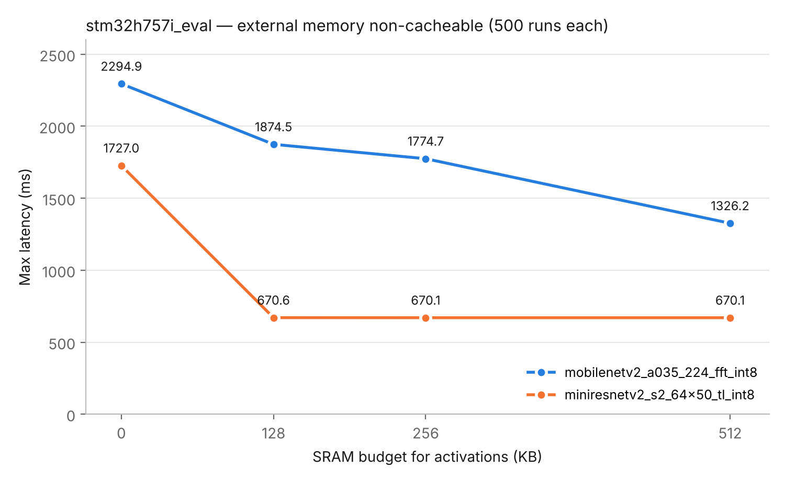

# 02 — Placement sweep, external memory non-cacheable

**Question:** same sweep as experiment 01, but with SDRAM marked non-cacheable — how large is the raw external-memory penalty when the cache cannot hide it?

| Item | Value |
|---|---|
| Study code | `core/bench/placement_sweep.c` (same as 01) |
| Port | `stm32h757i_eval`, built with `EXTMEM_CACHEABLE=0` |
| Models | `mobilenetv2_a035_224_fft_int8`, `miniresnetv2_s2_64x50_tl_int8` |
| SRAM budgets | 512, 256, 128, 0 KB |
| External memory | MPU region 0 @ 0xD0000000, Normal non-cacheable (TEX=1 C=0 B=0), set once |
| Runs | 10 warm-up + 500 timed, DWT cycles |

The only difference from 01 is the MPU attribute of the SDRAM region.

## Build
```
make                                   # all 8 configurations
make one MODEL=<model> SRAM_KB=<KB>    # a single configuration
```

## Results (`results/results.csv`)
| model | budget KB | act SRAM KB | act ext KB | min ms | mean ms | max ms | checksum |
|---|---|---|---|---|---|---|---|
| mobilenetv2_a035_224_fft_int8 | 512 | 392 | 735 | 1326.013 | 1326.132 | 1326.232 | 0x6E135E66 |
| mobilenetv2_a035_224_fft_int8 | 256 | 196 | 686 | 1773.768 | 1773.988 | 1774.652 | 0x6E135E66 |
| mobilenetv2_a035_224_fft_int8 | 128 | 98 | 882 | 1873.642 | 1873.980 | 1874.521 | 0x6E135E66 |
| mobilenetv2_a035_224_fft_int8 | 0 | 0 | 882 | 2293.541 | 2294.239 | 2294.926 | 0x6E135E66 |
| miniresnetv2_s2_64x50_tl_int8 | 0 | 0 | 110 | 1726.880 | 1726.928 | 1726.977 | 0x62FA5CE4 |

MiniResNet 512/256/128 KB place 0 B in SDRAM, so the cache attribute cannot affect them; they were not re-measured and equal experiment 01 (670.140 / 670.140 / 670.597 ms max). The plot uses those values.

Slowdown 512 → 0 KB (max): MobileNetV2 **+73.0 %**, MiniResNet **+157.7 %**.

| model | budget KB | 01 cacheable max ms | 02 non-cacheable max ms | ratio |
|---|---|---|---|---|
| MobileNetV2 | 512 | 1182.167 | 1326.232 | 1.12× |
| MobileNetV2 | 256 | 1183.895 | 1774.652 | 1.50× |
| MobileNetV2 | 128 | 1186.486 | 1874.521 | 1.58× |
| MobileNetV2 | 0 | 1190.576 | 2294.926 | 1.93× |
| MiniResNet | 0 | 673.956 | 1726.977 | 2.56× |



## Observations
- Without caching, latency rises steadily as the SRAM budget shrinks; the largest MobileNetV2 step is 512 → 256 KB, where the large early feature maps leave SRAM.
- MiniResNet is hit harder: its 7×7 and 3×3 convolutions re-read each input byte many times, and every re-read goes to SDRAM.
- Compared with 01, the D-cache hides almost the entire external-memory penalty.
