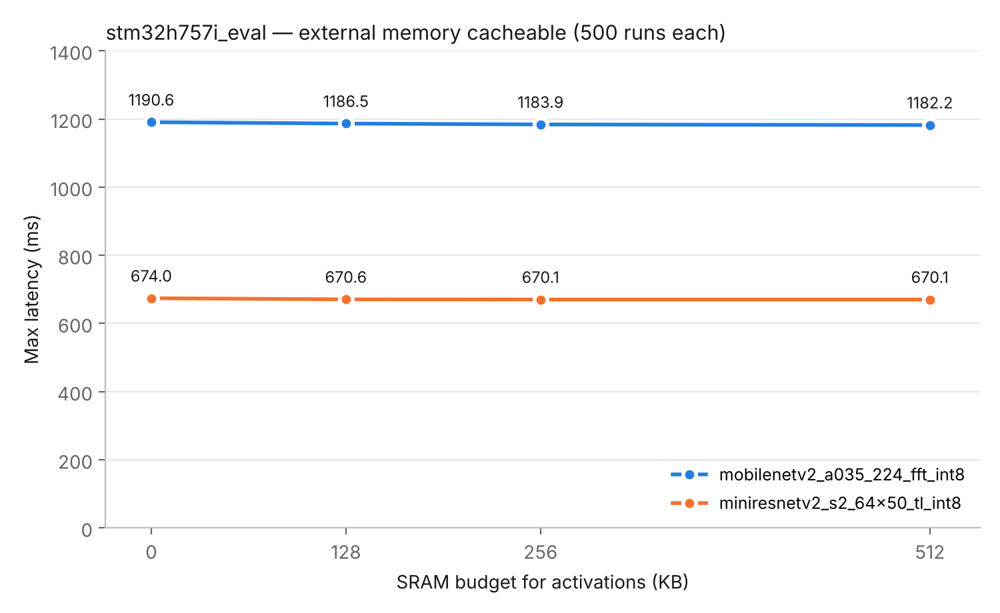
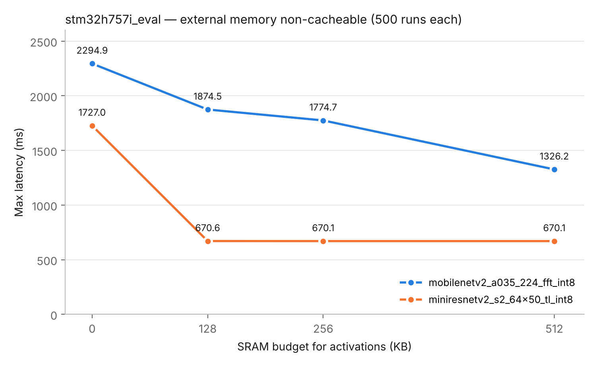

# Results — stm32h757i_eval

All experiments on this board, in one place. Raw data and plots live in each experiment's `results/` folder.

Board setup: [README.md](README.md) · Experiments: [experiments/](experiments/)

## 01 — Placement sweep, SDRAM cacheable
Max latency (ms), 500 timed runs:

| SRAM budget | MobileNetV2 | MiniResNet |
|---|---|---|
| 512 KB | 1182.167 | 670.140 |
| 256 KB | 1183.895 | 670.140 |
| 128 KB | 1186.486 | 670.597 |
| 0 KB | 1190.576 | 673.956 |
| **512 → 0 KB** | **+0.71 %** | **+0.57 %** |

Data: [experiments/01_placement_sweep_cached/results/results.csv](experiments/01_placement_sweep_cached/results/results.csv)

## 02 — Placement sweep, SDRAM non-cacheable
Max latency (ms), 500 timed runs:

| SRAM budget | MobileNetV2 | MiniResNet |
|---|---|---|
| 512 KB | 1326.232 | 670.140 * |
| 256 KB | 1774.652 | 670.140 * |
| 128 KB | 1874.521 | 670.597 * |
| 0 KB | 2294.926 | 1726.977 |
| **512 → 0 KB** | **+73.0 %** | **+157.7 %** |

\* no tensors in SDRAM at this budget, so the cache attribute has no effect (value from 01).

Data: [experiments/02_placement_sweep_noncached/results/results.csv](experiments/02_placement_sweep_noncached/results/results.csv)

## 01 vs 02 — what the cache hides
| Model | Budget | Cacheable ms | Non-cacheable ms | Ratio |
|---|---|---|---|---|
| MobileNetV2 | 512 KB | 1182.167 | 1326.232 | 1.12× |
| MobileNetV2 | 256 KB | 1183.895 | 1774.652 | 1.50× |
| MobileNetV2 | 128 KB | 1186.486 | 1874.521 | 1.58× |
| MobileNetV2 | 0 KB | 1190.576 | 2294.926 | 1.93× |
| MiniResNet | 0 KB | 673.956 | 1726.977 | 2.56× |

## 03 — Memory-management overheads
1000 timed iterations each:

| Test | Mean µs | Max µs | Throughput |
|---|---|---|---|
| MPU region reprogram | 0.076 | 0.105 | — |
| D-cache clean + invalidate, 128 KB | 80.685 | 80.717 | — |
| MDMA copy 128 KB, AXI SRAM → SDRAM | 333.582 | 333.640 | 392.9 MB/s |

Data: [experiments/03_overhead_bench/results/results.csv](experiments/03_overhead_bench/results/results.csv)

## Findings
1. With SDRAM cacheable, moving every activation from SRAM to SDRAM costs under 1 % latency for both models.
2. With SDRAM non-cacheable, the same move costs +73 % (MobileNetV2) and +158 % (MiniResNet): the D-cache hides almost the entire external-memory penalty.
3. Without the cache, latency grows steadily as the SRAM budget shrinks; for MobileNetV2 the largest step is 512 → 256 KB, where the large early feature maps leave SRAM.
4. MiniResNet is more sensitive because its 7×7 and 3×3 convolutions re-read each input byte many times.
5. Managing the hierarchy explicitly is cheap: an MPU reprogram is ~30 cycles, cache maintenance ~7.9 cycles per 32-byte line, and MDMA moves 128 KB in 0.33 ms at ~98 % of the SDRAM bus peak.
6. All runs verified every layer against TFLite on the board, and output checksums were identical across all placements; run-to-run spread was below 1.5 ms in every configuration.
